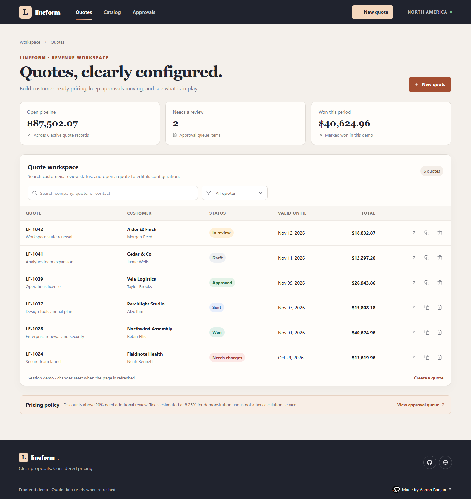
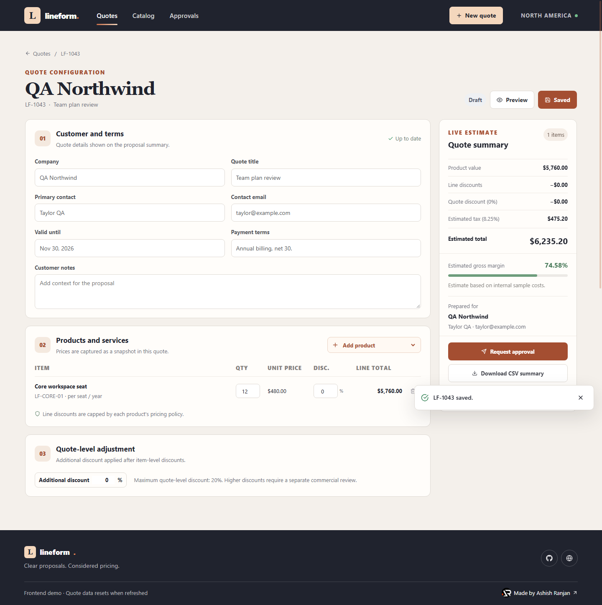
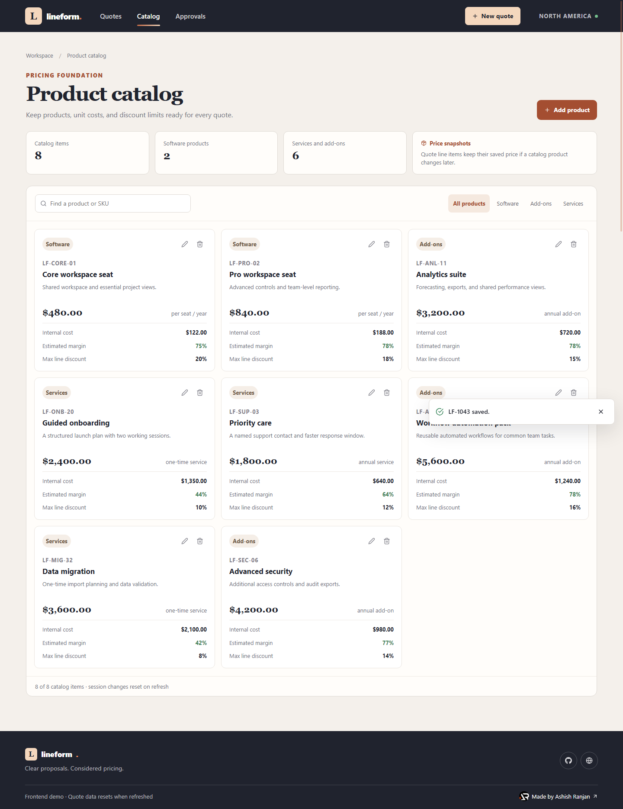
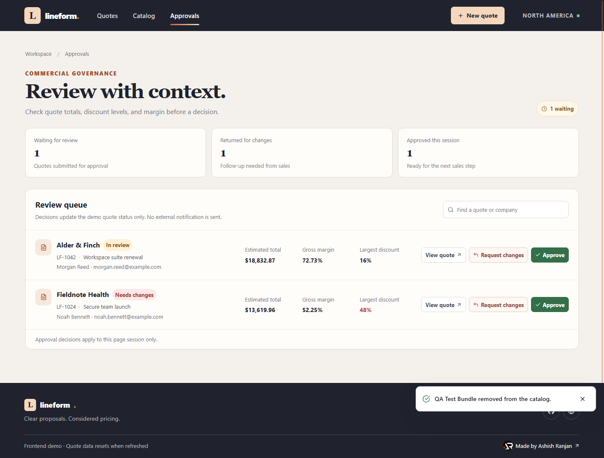
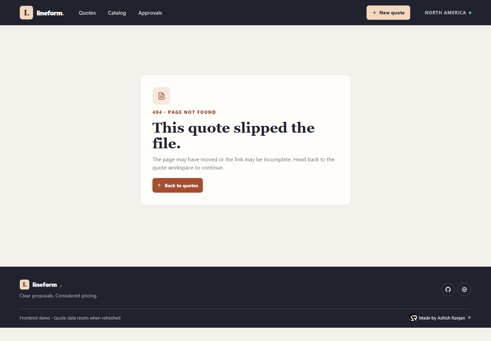
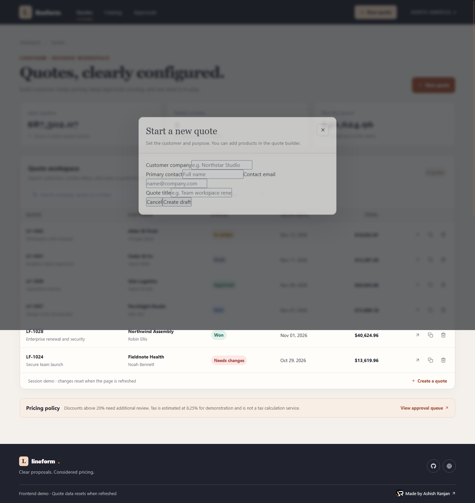
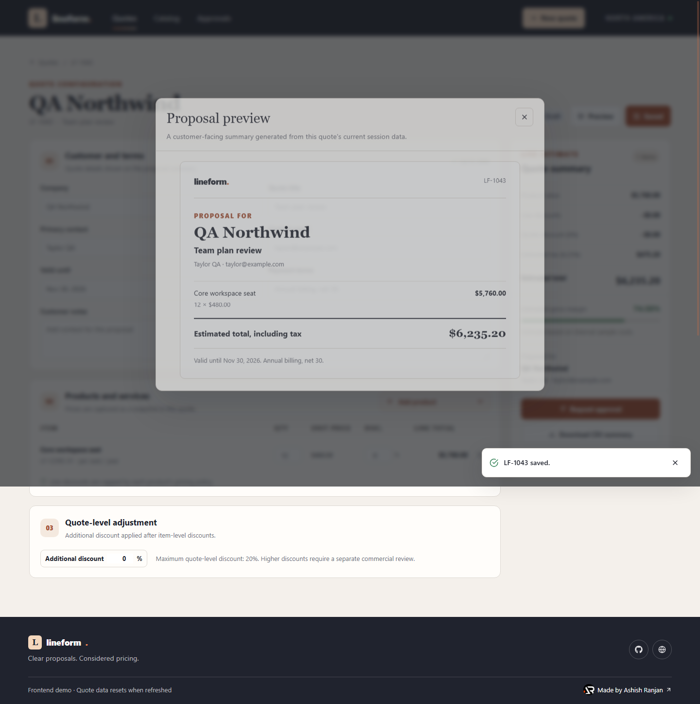
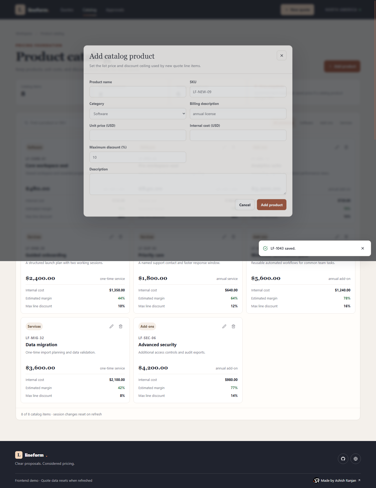
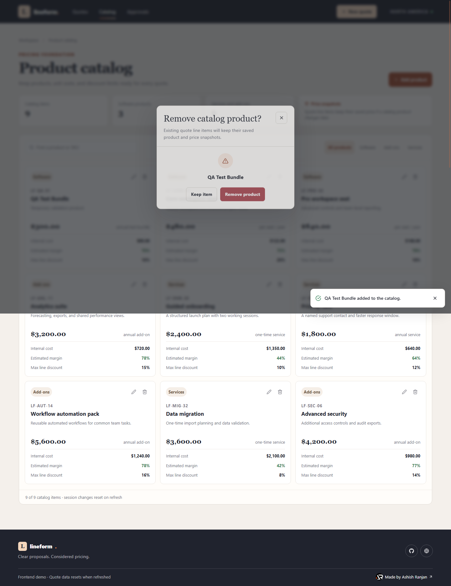
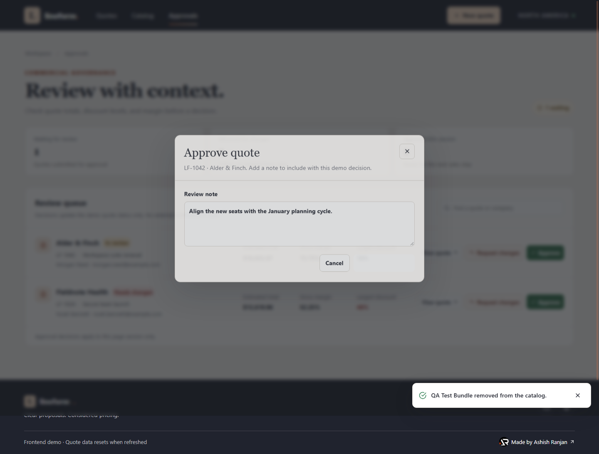



# Lineform | Quote workspace

A frontend-only CPQ demo for configuring customer proposals, reviewing price and margin, and routing quotes through a lightweight approval flow.

## Screenshots

### Pages

| Workspace | Preview |
| --- | --- |
| Quotes |  |
| Quote builder |  |
| Product catalog |  |
| Approval queue |  |
| Not found |  |

### Dialogs

| Action | Preview |
| --- | --- |
| Create quote |  |
| Proposal preview |  |
| Add product |  |
| Confirm product removal |  |
| Approve quote |  |

## Included workflows

- Search and filter quotes by customer, contact, quote number, and status.
- Create and duplicate quote drafts, then edit customer details, terms, and notes.
- Add catalog items to a quote, change quantities, and apply product-limited discounts.
- Review estimated discounts, tax, total, and gross margin as quote lines change.
- Preview a customer-facing proposal summary and download a CSV quote summary.
- Submit a quote to the demo approval queue, approve it, or return it with review notes.
- Add, update, search, filter, and remove catalog products with custom confirmation dialogs.
- Receive toast feedback for completed actions and use responsive navigation on small screens.

## Demo boundaries

All sample records and edits use React state in the browser and reset after a refresh. No API, team accounts, email delivery, external approval, payment, or tax service is connected. The tax rate is a sample estimate, not tax advice or a production calculation.

A production version could connect these screens to an authenticated quote API with team permissions, audited approval decisions, customer delivery, and configurable tax rules.

## Run locally

```bash
npm install
npm run dev
```

## Build and deploy

```bash
npm run lint
npm run build
npm run deploy
```

The deploy script builds the site, copies `index.html` to `404.html` for GitHub Pages route fallback, then publishes `dist` to the `gh-pages` branch.

## Links

- Live demo: [https://a2rp.github.io/sales-quoting-cpq/](https://a2rp.github.io/sales-quoting-cpq/)
- GitHub repository: [https://github.com/a2rp/sales-quoting-cpq](https://github.com/a2rp/sales-quoting-cpq)
- Portfolio: [https://www.ashishranjan.net](https://www.ashishranjan.net)

## Support

- Support: [https://a2rp-donation-page.netlify.app/](https://a2rp-donation-page.netlify.app/)
- Buy Me a Coffee: [https://www.buymeacoffee.com/a2rp](https://www.buymeacoffee.com/a2rp)
